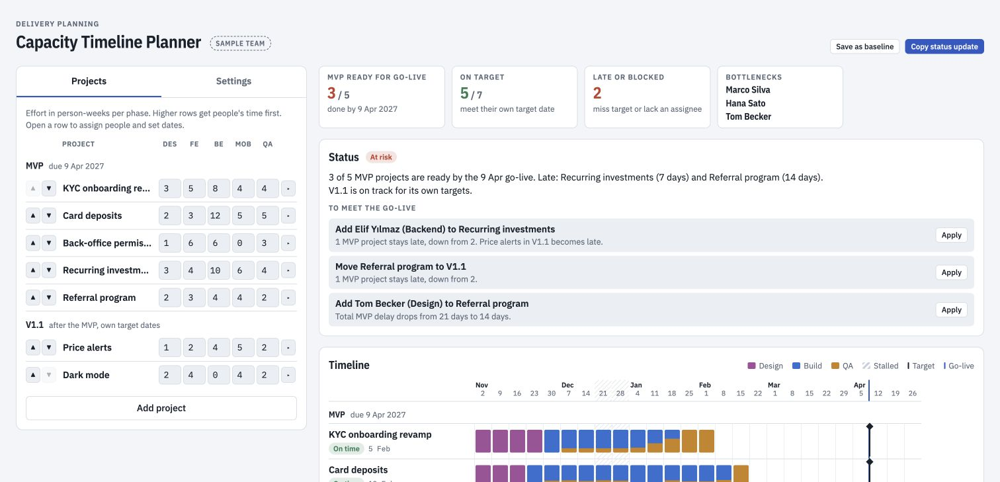

# Capacity Timeline Planner

**Browser:** working local scheduling simulation. **Claude artifact:** same local functionality. **Live integrations:** none implemented.

## Try it

1. Open `index.html` in a browser; the initial team and projects are fictional.
2. Edit project effort, dependencies, and MVP/V1.1 release assignments in **Projects**.
3. In **Settings**, edit people, roles, monthly time off, focus time, and planning dates.
4. Review the timeline and bottlenecks. Try a recommended change and compare the result.

The planner runs entirely in the page and saves edits in local storage. Linear-style sample labels are not a live import. Use the [skill](skills/capacity-timeline-planner/SKILL.md) separately to gather inputs through a connector, then enter them in the planner.

## Model assumptions

- Effort is in person-weeks; work is allocated in weekly steps and completion is reported at week end.
- Design precedes build. QA advances with build progress. Dependencies wait until the next week after completion.
- Priority order determines how shared capacity is allocated; MVP comes before V1.1.
- Time off is entered per month and spread across that month's working days, rather than placed on exact dates.
- The holiday calendar is a fixed illustrative list: December 24–26 and 31, and January 1. It is not a country-specific calendar.
- Cyclic dependencies, unavailable dependencies, and estimates need human review. Dates are scenario outputs, not delivery guarantees.

## Validation

Local regression checks exercise capacity contention, dependency ordering, missing roles, and leave. The [fixture](examples/capacity-timeline-planner.json) gives a small hand-checkable plan. See [validation](docs/validation.md) for current coverage.

## Standalone repository

This app was extracted from PM Toolkit. It contains its own HTML, screenshot, license, companion instructions and relevant examples. There is no build step and no package installation required to open the page. Optional Google Fonts requests need an internet connection; system fonts are the fallback.

For a local web address, run `python3 -m http.server 8000` in this folder and open [the app](http://localhost:8000). This local server does not enable any connected feature.

Companion instructions are included as files for a compatible assistant host. They do not install themselves, connect accounts, or schedule runs. Review their proposed external writes before authorizing them.

Run the inherited offline regression checks with `node --test tests/app.test.cjs` (Node.js 20 or newer). No model calls or credentials are needed.
